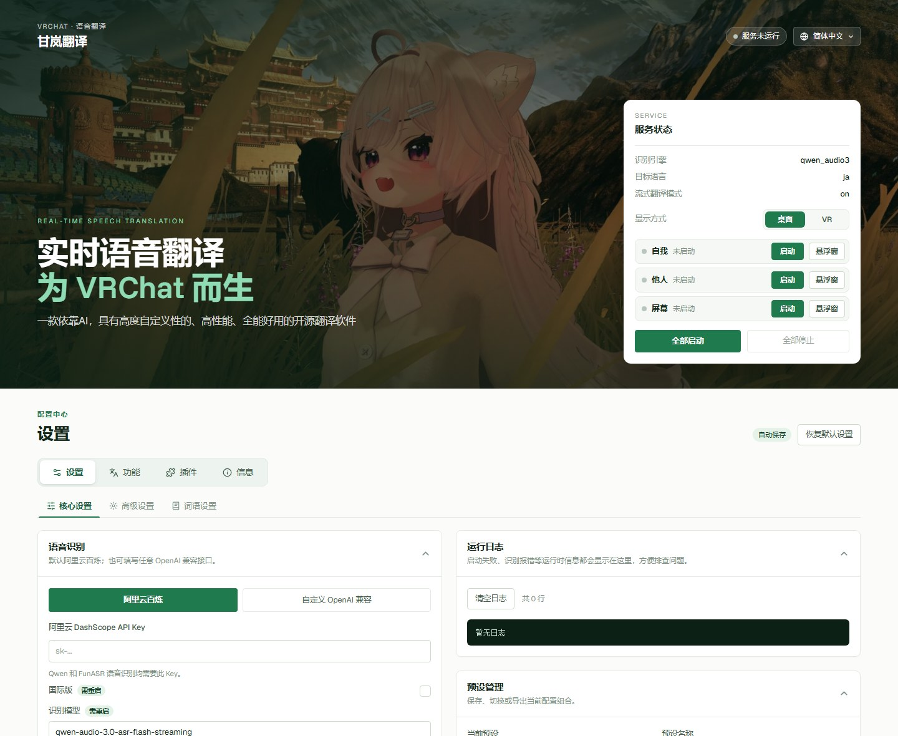

<div align="center">

# 甘嵐翻訳 · Ganlan Translate

**VRChat のためのリアルタイム音声翻訳**

AI を活用した、自由にカスタマイズできる高性能でオールインワンなオープンソース翻訳ソフト。
あなたの話した言葉をリアルタイムに翻訳して VRChat のチャットボックスに送ります。ほかの人の声や画面上の文字も翻訳して表示できます。

[简体中文](README.md) · [English](README.en.md) · **日本語**

[最新版をダウンロード](https://github.com/ganlanqwq/GanlanTranslate/releases/latest) · [MIT ライセンス](LICENSE.md)



</div>

## できること

甘嵐翻訳には 3 つの翻訳モードがあり、個別にも同時にも使えます。

| モード | 聞く / 見るもの | 翻訳の表示先 |
|---|---|---|
| **自己翻訳** | あなたのマイク | VRChat のチャットボックス（OSC）と自己ウィンドウ |
| **他者翻訳** | VRChat 内のほかのプレイヤーの声 | 他者ウィンドウ（話者を A、B、C… で表示） |
| **画面翻訳** | VRChat ウィンドウ内の文字（ホットキーで 1 回撮影） | 画面ウィンドウ（原文の下に訳文を 1 行ずつ） |

ほかにも：

- **VR 手首字幕**：ヘッドセットをかぶったままでも読めます。SteamVR で手首を上げると訳文が見え、SteamVR のメニューからモードの切り替えや言語の変更ができます。
- **用語設定**：認識用のホットワード（フレンドの名前、ワールド名、界隈の言葉など）を追加したり、特定の単語の訳し方を決めたりできます。
- **4 つの表示言語**：簡体字中国語、English、日本語、한국어。初期設定では Windows の表示言語に合わせます。

## 機能紹介

### 自己翻訳

- **話しながら翻訳**：LLM のストリーミング翻訳で、言い終わる前に相手に意味が伝わります（トークンを多めに使います。オフにもできます）。
- **音声認識エンジンを選べる**：初期設定は Alibaba Cloud Model Studio（百煉）の Qwen-Audio-3。Qwen3 ASR、Fun-ASR、Soniox、Doubao のほか、任意の OpenAI 互換の音声 API（音声を理解できるマルチモーダル LLM、または Whisper 互換の文字起こし API）も使えます。
- **翻訳は LLM で**：OpenAI 互換の API ならどれでも使えます（Model Studio の互換モード、DeepSeek、OpenRouter など）。丁寧さ（友だちとの会話 / 初対面 / とても丁寧）や文体も調整できます。
- **2 言語を同時に出力**：第 2 出力言語を設定すると、チャットボックスに 2 行の訳文を表示します。フォールバック言語を設定すると、話した言葉がすでに翻訳先言語だったときに代わりにその言語へ翻訳します。
- **VRChat のマイクに連動**：VRChat でミュート中は認識せず、料金もかかりません。ミュートを解除すると自動で認識を始めます。0.8 秒以内にマイクを 2 回すばやく切り替えるとチャットボックスを消去します（「詳細設定」でオフにできます）。
- **文脈を理解**：直近の会話を一緒に送ります。VRCX と組み合わせると、今いるワールドとインスタンス内のプレイヤー名も送るので、名前やワールド名の誤訳が減ります。
- **チャットボックスの細かい対応**：長さの自動調整、入力中表示、アラビア語 / ヘブライ語の整形、日本語のふりがな、中国語のピンイン、Unicode の装飾フォントなど。

### 他者翻訳

- VRChat の音声だけを録音します。音楽、ボイスチャットアプリ、システム音は入りません。
- 声で話者を区別し、ウィンドウに A〜Z で表示します。
- 相手の言語を自動で判定し（約 176 言語）、原文の後ろに表示してから、設定した言語に翻訳します。
- 他者の翻訳先言語は自己翻訳とは別に設定でき、ウィンドウ上のボタンですぐ切り替えられます。自己翻訳を「音声認識のみ」にしていても他者翻訳は動きます。

### 画面翻訳

- グローバルホットキー（初期設定 `Ctrl+Alt+F8`）か画面ウィンドウのカメラボタンで、VRChat のウィンドウを 1 回撮影します。ほかのウィンドウに隠れていても撮れます（最小化中は不可）。
- 画像を読めるモデルで画面上の文字を認識し（初期設定は Qwen OCR `qwen-vl-ocr`。画像を扱える OpenAI 互換モデルにも変更可）、ブロックごとに言語を表示して翻訳します。
- 看板、メニュー、ワールド内の説明文を読むのに便利です。

### VR 手首字幕（SteamVR）

- メイン画面で **表示方法** を **VR** に切り替え、**起動** を押すと VR 用の補助アプリが立ち上がります。以降は SteamVR を開くたびに自動で起動します。
- 左右の手首に字幕カードが 1 枚ずつあり、手首を上げたときだけ表示されます。位置、大きさ、透明度、文字サイズを調整できます。
- SteamVR のレーザーでカードのボタンを押すと、履歴をさかのぼったり画面翻訳を実行したりできます。
- SteamVR のメニューに甘嵐翻訳の設定ページがあり、3 つのモードのオン / オフ、モードごとの翻訳先言語、手首に表示する内容を変更できます。

### 用語設定

- **認識ホットワード**：中国語・英語・日本語の 3 種類。1 行に 1 語で、自己翻訳と他者翻訳で共用します。
- **翻訳用語**：原文に特定のキーワードが出てきたときの訳し方をモデルに伝えます。翻訳先言語ごとに保存し、保存した次の文から反映されます。
- 内蔵の辞書は読み取り専用で表示します。自分で追加したものは別に保存されるので、アップデートしても消えません。

### その他

- **プリセット**：設定一式をプリセットとして保存し、いつでも切り替えられます。ファイルに書き出してフレンドと共有することもできます。プリセットに API Key は含まれません。
- **フローティングウィンドウ**：自己・他者・画面の 3 つのウィンドウを別々に開けて、最前面に固定することもできます。
- **トレイ**：メイン画面を閉じると右下のトレイにしまわれるだけです。もう一度起動すると元のウィンドウが前に出てきて、2 つ起動することはありません。

## ダウンロードとインストール

1. [Releases](https://github.com/ganlanqwq/GanlanTranslate/releases/latest) から `GanlanTranslate-Setup-<バージョン>.exe` をダウンロードします。
2. インストーラーを実行します。初期設定のインストール先は `C:\Program Files (x86)\Ganlan Translate` です。
3. 初回起動時に Windows SmartScreen に止められた場合は、「詳細情報」→「実行」を押してください。

動作環境：Windows 10 / 11（64 ビット）。VR 手首字幕には SteamVR が必要です。

テスト版（プログラム名 `GanLan.exe`）の上からインストールすると、プリセット、自分で追加したホットワードと用語、VR 補助アプリの設定、ダウンロード済みのモデルを新しいフォルダーへ自動で移し、古いフォルダーを削除します。

## はじめかた

1. **Key を用意する**
   - Alibaba Cloud Model Studio（DashScope）の Key：初期設定の音声認識と画面の文字認識に使います。[Model Studio のコンソール](https://modelstudio.console.aliyun.com/ap-southeast-1?tab=doc#/api-key)で作成できます（新規アカウントには通常無料枠があります）。国際版サイトの Key を使う場合は **国際版** にチェックを入れてください。
   - 翻訳用 LLM の Key：OpenAI 互換の API ならどれでも使えます。Model Studio（国際版）なら Base URL に `https://dashscope-intl.aliyuncs.com/compatible-mode/v1`、モデル名に `qwen-plus` などを入力します。
2. **アプリに入力する**：甘嵐翻訳を開き、**コア設定** で Key、LLM の URL、モデル名を入力します。設定は自動で保存されます。
3. **VRChat の OSC をオンにする**：VRChat のアクションメニュー → `Options` → `OSC` → `Enable`。
4. **言語を設定する**：**自己翻訳** で翻訳先言語（例：`en`、`zh-CN`）を、**他者翻訳** と **画面翻訳** で読みたい言語（例：`ja`）を設定します。
5. **開始する**：右上のサービスカードで使いたいモードを開始するか、**すべて開始** を押します。訳文を見たいときは各行の右にある **ウィンドウ** を押してください。

使わないときはサービスを止めておくと、認識の利用枠を無駄に使いません。

## データとプライバシー

- API Key はこのパソコンのアプリ内にだけ保存されます。プリセットファイルには書き込まれず、対応するサービス提供元以外には送信されません。
- 音声、スクリーンショット、テキストは、自分で設定した認識 / 翻訳 / 画像認識サービスにだけ送られます（**逆翻訳** を有効にした場合は Google 翻訳も使います）。
- プリセット、ホットワード、用語、VR の設定はインストールフォルダーに保存され、上書きアップデートでも消えません。

## よくある質問

<details>
<summary><b>自己翻訳が反応しない</b></summary>

- 自己翻訳は VRChat が起動していて、マイクがオンのときだけ認識します。VRChat が起動していること、OSC がオンになっていること、ゲーム内でミュートしていないことを確認してください。
- **自己翻訳** で正しいマイクを選んでいるか確認してください。
- **コア設定** の下にある **実行ログ** を見てください。エラーがあればここに表示されます。

</details>

<details>
<summary><b>VRChat のチャットボックスに表示されない</b></summary>

- VRChat の `Options → OSC` がオンになっているか確認してください。送信ポートの初期値は UDP 9000 です。
- ほかのプログラムが 9000 番ポートを使っていないか確認してください。ゲーム用の高速化ツール / VPN を使う場合は「プロセスモード」を選ばないでください。
- **詳細設定** の **互換モード** は Resonite などほかのゲーム用です。VRChat ではオンにしないでください。

</details>

<details>
<summary><b>ログに 401 / api-key is invalid と出る</b></summary>

Key と **国際版** のチェックが合っていません。中国サイトの Key ではチェックを外し、国際版サイトの Key ではチェックを入れてください。

</details>

<details>
<summary><b>他者翻訳の字幕が出ない</b></summary>

- 先に VRChat を起動してください。甘嵐翻訳は VRChat の音声だけを録音します。
- 声の高さがとても近い 2 人は同じ文字で表示されることがあります。混ざった音声から話者を区別するための制限です。

</details>

<details>
<summary><b>画面翻訳で撮影できない / ホットキーが効かない</b></summary>

- VRChat が最小化中や排他的フルスクリーンのときは撮影できません。ウィンドウモードかボーダーレスウィンドウにしてください。
- ホットキーがほかのアプリに使われている可能性があります。**画面翻訳** で別のキーに変え、画面モードを再起動してください。ホットキーがなくても、ウィンドウのカメラボタンで撮影できます。

</details>

<details>
<summary><b>VR で手首に字幕が出ない</b></summary>

- メイン画面の **表示方法** が VR になっていて、右上に「VR 接続済み」と表示されている必要があります。
- 手首カードは初期設定では手首を上げたときだけ表示されます。手のひらを下に向けて手首を上げ、手の甲を見てください。
- SteamVR メニューの甘嵐翻訳ページで、**手首表示** が **オフ** になっていないか確認してください。

</details>

## ソースから実行する

Python 3.13（開発とパッケージ作成に使っているバージョン）と Git（依存パッケージの 1 つを GitHub からインストールします）が必要です。

```bash
git clone https://github.com/ganlanqwq/GanlanTranslate.git
cd GanlanTranslate
python -m venv .venv
.venv\Scripts\python -m pip install -r requirements.txt

# デスクトップウィンドウ + トレイ（インストール版と同じ）
.venv\Scripts\python run_ui.py

# または Web コンソールだけを起動し、ブラウザで http://127.0.0.1:5001 を開く
.venv\Scripts\python ui\app.py
```

インストール版とソース版を同時に起動しないでください。同じポートとマイクを取り合います。

### インストーラーを作る

[NSIS](https://nsis.sourceforge.io/) が必要です。

```bash
.venv\Scripts\python -m PyInstaller GanlanTranslate.spec --noconfirm --distpath build_installer\dist --workpath build_installer\work
"C:\Program Files (x86)\NSIS\makensis.exe" installer.nsi
```

インストーラーは `build_installer\GanlanTranslate-Setup-<バージョン>.exe` に出力されます。バージョン番号は `installer.nsi` と `ui/app.py` の 2 か所にあるので、一緒に変更してください。

### ディレクトリ構成

| パス | 内容 |
|---|---|
| `ui/` | Web コンソール（Flask バックエンド、ページ、スタイル、スクリプト） |
| `qt_ui/`、`run_ui.py`、`tray_app.py` | デスクトップウィンドウとトレイ |
| `main.py`、`recognition_handler.py` | 自己翻訳 |
| `others_pipeline.py`、`speaker_id.py` | 他者翻訳、話者の区別 |
| `screen_translation.py` | 画面翻訳 |
| `vr_overlay/`、`vr_bridge.py` | SteamVR の手首字幕とメニューページ |
| `speech_recognizers/`、`streaming_translation/` | 各社の音声認識・翻訳 API |
| `hot_words/`、`terminology/` | 内蔵のホットワードと用語 |
| `tailwind_build/` | 画面のスタイルを再ビルドするための Tailwind 設定 |

## 謝辞

自己翻訳の翻訳フローは febilly さんの [Yakutan](https://github.com/febilly/Yakutan) を参考にしています。アイデアとコードに感謝します。

使用・参考にしたオープンソースプロジェクト：

- Alibaba Cloud Fun-ASR のサンプルコード
- [LiveCaptions-Translator](https://github.com/SakiRinn/LiveCaptions-Translator)（Google 翻訳 API）
- [PuriPuly-heart](https://github.com/kapitalismho/PuriPuly-heart)（一部のプロンプト）
- [LiveTranslate](https://github.com/TheDeathDragon/LiveTranslate)、[SenseVoice-python](https://github.com/lovemefan/SenseVoice-python)、[SenseVoice](https://github.com/FunAudioLLM/SenseVoice)、[Qwen3-ASR-GGUF](https://github.com/HaujetZhao/Qwen3-ASR-GGUF)、[llama.cpp](https://github.com/ggml-org/llama.cpp)（ローカル認識）
- [Silero VAD](https://github.com/snakers4/silero-vad)（音声区間検出）
- [vrchat_oscquery](https://github.com/theepicsnail/vrchat_oscquery)、[pyopenvr](https://github.com/cmbruns/pyopenvr)、[PySide6](https://doc.qt.io/qtforpython-6/)、[Flask](https://flask.palletsprojects.com/)、[fast-langdetect](https://github.com/LlmKira/fast-langdetect)

スペシャルサンクス（順不同）：nino、wood、苌梦、febilly。それぞれのエピソードはアプリの **アプリ情報** ページに書いてあります。

## フィードバック

不具合の報告や提案は [Issues](https://github.com/ganlanqwq/GanlanTranslate/issues) へどうぞ。アプリの **アプリ情報** ページにある連絡先からも受け付けています。

## ライセンス

[MIT](LICENSE.md)
