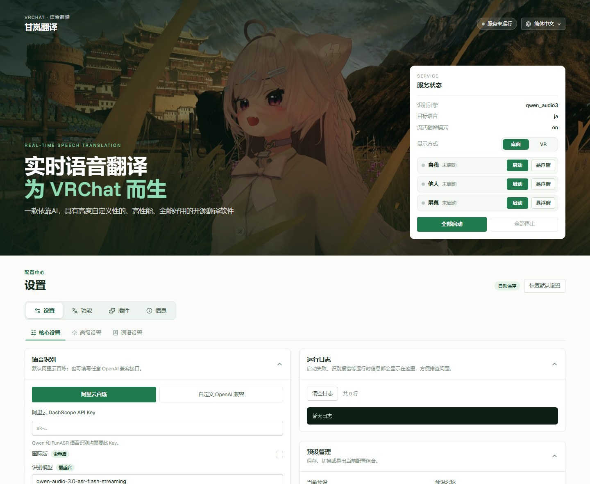

<div align="center">

# 甘岚翻译 · Ganlan Translate

**为 VRChat 而生的实时语音翻译**

一款依靠 AI、高度可自定义、高性能、全能好用的开源翻译软件。
你说的话实时翻译后发到 VRChat 聊天框；别人说的话、画面上的文字，也能翻译给你看。

**简体中文** · [English](README.en.md) · [日本語](README.ja.md)

[下载最新版](https://github.com/ganlanqwq/GanlanTranslate/releases/latest) · [MIT 许可证](LICENSE.md)



</div>

## 能做什么

甘岚翻译有三个翻译模式，可以单独开，也可以同时开：

| 模式 | 听 / 看什么 | 译文去哪里 |
|---|---|---|
| **自我翻译** | 你的麦克风 | VRChat 聊天框（OSC），以及自我悬浮窗 |
| **翻译他人** | VRChat 游戏里其他人的声音 | 他人悬浮窗，按说话人标出 A、B、C… |
| **翻译画面** | VRChat 窗口里的文字（按热键截一次） | 屏幕悬浮窗，每段原文下面一行译文 |

另外还有：

- **VR 手腕字幕**：戴着头显也能看。SteamVR 里抬起手腕就能看到译文，在 SteamVR 菜单里就能开关模式、换语言。
- **词语设置**：自己加识别热词（朋友的名字、世界名、圈内梗），自己定某个词该怎么翻。
- **插件**：把 .zip 插件包拖进窗口就能装，每个插件可以单独开关、设置和删除。
- **个性化**：换主题色（整套颜色跟着变），换首页图片（自带裁剪）和首页文字，配置可以单独导出。
- **四种界面语言**：简体中文、English、日本語、한국어，默认跟随 Windows 的显示语言。

## 功能介绍

### 自我翻译

- **边说边翻**：大模型流式翻译，不用等整句话说完对方就能看到意思（会多用一些 token，可以关）。
- **识别引擎可选**：百炼模式用阿里云百炼的 Qwen-Audio-3 实时识别；OpenAI 兼容模式可以填任意 Whisper 兼容的转写接口（`/audio/transcriptions`）。
- **翻译用大模型**：任何 OpenAI 兼容接口都能用，比如百炼兼容模式、DeepSeek、OpenRouter。可以调语气的正式程度（朋友聊天 / 初次见面 / 非常礼貌）和句子风格。
- **两种语言同时出**：可以设第二输出语言，聊天框里一次显示两行译文；还能设备用语言，你说的正好是目标语言时自动改翻成备用语言。
- **跟着 VRChat 麦克风走**：VRChat 里闭麦时不识别、不花钱，开麦自动开始；0.8 秒内快速开关麦两次会清空聊天框（可以在高级设置里关掉）。
- **懂上下文**：带上最近几句对话；配合 VRCX 还能带上当前世界和房间里的玩家名，人名、世界名不容易翻错。
- **聊天框细节**：长度自动裁剪、正在输入状态、阿拉伯文 / 希伯来文重排、日语加假名、中文加拼音、Unicode 花式字体等。

### 翻译他人

- 只录 VRChat 这个程序的声音，不会录进你的音乐、语音软件或系统提示音。
- 按音色区分说话人，悬浮窗里用 A–Z 标出是谁说的。
- 自动识别对方说的是哪种语言（约 176 种），在原文后面标出来，再翻译成你设的语言。
- 他人的译文语言和自我分开设置，悬浮窗上有快捷切换按钮。即使自我设成「仅识别」，他人照样翻译。

### 翻译画面

- 按全局热键（默认 `Ctrl+Alt+F8`）或点屏幕悬浮窗的相机按钮，截一次 VRChat 窗口。VRChat 被别的窗口挡住也能截（最小化不行）。
- 用视觉模型认出画面上的文字（默认千问 OCR `qwen3.5-ocr`，国际版用 `qwen-vl-ocr`，也可以换成任何能看图的 OpenAI 兼容模型）。画面上折成几行的同一句话会先拼回一整句，再按段标出语言、翻译。
- 适合看告示牌、菜单、世界里的说明文字。

### VR 手腕字幕（SteamVR）

- 主程序里把「显示方式」切到 **VR**，点「启动」打开 VR 附属程序。之后每次打开 SteamVR 都会自动启动它。
- 左右手腕各一张字幕卡片，抬腕才显示。在 SteamVR 菜单的「调整位置和角度」里可以调前后、上下、远近，任意方向旋转（可以转一整圈），还有大小、不透明度、字号；左右手对称。
- 想往回看历史，在 SteamVR 菜单的甘岚翻译页里点「他人」「屏幕」各自的翻页按钮，手腕卡片会跟着翻。手腕卡片本身不能点，所以翻腕看字幕不会让 VRChat 进入 AFK。
- SteamVR 菜单里有甘岚翻译的设置页：开关三个模式、换每个模式的译文语言、选手腕显示什么内容。

### 词语设置

- **识别热词**：中文、英语、日语各一份，一行一个，自我和他人共用。
- **翻译术语**：原文出现某个关键词时告诉模型怎么翻，按译文语言分开保存，保存后下一句就生效。
- 内置词库只读显示，你自己加的单独保存，升级不会丢。

### 插件

- 插件包是一个 .zip，里面的 `plugin.json` 记录名字、版本、作者和设置项。把它拖进甘岚翻译窗口（哪一页都行），或者在「插件」页点「导入插件」就装好了。
- 「插件」页可以启用 / 禁用、删除，点齿轮按钮改这个插件自己的设置；「信息 → 软件信息」里能看到装了哪些插件，并打开插件文件夹。
- 插件能在翻译之前改你说的话（加进去的内容会跟着一起翻译）、改发到聊天框的文字，也能拿到每一句译文。示例插件「聊天框前后缀」给你说的每句话前后加上自定义内容；「语音控制」插件可以用说的话启动 / 关闭翻译、翻译一次画面、改主语言和第二语言、设置 VR 手腕卡片（指定口令，或者先说唤醒词再让大模型理解意思），说口令的那句话不翻译、不发聊天框。
- 插件放在程序目录的 `plugins` 文件夹里，覆盖升级不会动它。插件能运行代码，只安装你信任的插件。
- 想自己写插件，看 [插件开发说明](docs/插件开发.md) 和示例 [`docs/plugin-example/`](docs/plugin-example/)、[`docs/plugin-voice-control/`](docs/plugin-voice-control/)。

### 个性化

- 在「个性化 → 配色」里选一个预设配色，或者自己挑主题色（能输十六进制色号，也能用调色盘）。换主题色时整套颜色一起变，文字和底色的对比度不变；背景、卡片、文字、首页强调色和遮罩色也可以单独改。
- 在「个性化 → 首页」里换首页图片：选好图片先裁剪（横幅 5:2、宽屏 16:9、超宽 21:9），以后还能重新裁剪；遮罩浓度可调。首页的小标题、两行标题和介绍也能改成自己的话。
- 个性化配置单独保存在程序目录的 `personalization.json` 和 `personalization` 文件夹里，和预设分开；可以单独导出成一个文件（图片也在里面），在别的电脑上导入。

### 其他

- **预设**：把一整套配置存成预设，随时切换，也能导出成文件分享给朋友。导出的文件名就是预设名（比如 `test.json`）。默认不带 API Key；要带的话得勾选并确认三次警告，文件里的 Key 是明文。
- **运行日志**：「核心设置」右边的运行日志里有「分析错误」按钮：没填 API Key 时直接用内置规则找问题，填了 Key 就让翻译模型分析日志并用弹窗给出原因和解决办法（发出去之前会去掉 Key）。「信息 → 软件信息」里可以导出日志，出问题时发给开发者。
- **悬浮窗**：自我、他人、屏幕三个悬浮窗可以分开打开，可以设置成置顶悬浮。
- **托盘**：关掉主窗口只是缩到右下角托盘，再次打开程序会把原来的窗口叫出来，不会开两个。右键托盘图标可以直接启停三个模式、分别开关三个悬浮窗。

## 下载和安装

1. 到 [Releases](https://github.com/ganlanqwq/GanlanTranslate/releases/latest) 下载 `GanlanTranslate-Setup-<版本>.exe`。
2. 运行安装包，默认装到 `C:\Program Files (x86)\Ganlan Translate`。
3. 第一次运行如果被 Windows SmartScreen 拦住，点「更多信息」→「仍要运行」。

系统要求：Windows 10 / 11（64 位）。用 VR 手腕字幕需要 SteamVR。

从测试版（程序名 `GanLan.exe`）覆盖安装时，会自动把预设、自定义热词和术语、VR 附属程序设置、下载过的模型搬到新目录，再删掉旧目录。

卸载：在「信息 → 软件信息」里点「卸载…」，或者在 Windows 的「设置 → 应用」里卸载。卸载时可以选择保留预设、插件、个性化配置、自定义热词和术语、下载的模型（默认保留）。

## 快速上手

1. **准备 Key**：最省事的是在[阿里云百炼控制台](https://bailian.console.aliyun.com/)开通百炼、创建一个 API Key，新账号一般有免费额度。
2. **填进软件**：打开甘岚翻译，在「核心设置 → API 配置」里选一种方式，设置会自动保存：
   - **百炼**（推荐）：只填一个百炼 Key，语音识别、翻译和图像识别都用它，地址不用填。国际站的 Key 记得勾上「国际版」。用到的三个模型在「模型」里，可以改。
   - **OpenAI 兼容**：语音识别、翻译、图像识别各自填接口地址、Key 和模型（比如 DeepSeek、OpenAI、OpenRouter），语音识别要用 Whisper 那种 `/audio/transcriptions` 接口。
3. **打开 VRChat 的 OSC**：VRChat 圆盘菜单 → `Options` → `OSC` → `Enable`。
4. **设置语言**：在「自我翻译」里设目标语言（比如 `ja`、`en`），在「翻译他人」「翻译画面」里设你想看的译文语言（比如 `zh-CN`）。
5. **启动**：在右上角的服务卡片里启动要用的模式，或者点「全部启动」。需要看译文时点每行右边的「悬浮窗」。

不用的时候记得停掉服务，免得一直占用识别额度。

## 数据和隐私

- API Key 只保存在本机程序里，不会写进预设文件，也不会被上传到除对应服务商以外的地方。导出预设时如果选了带上 Key，文件里的 Key 是明文，只在自己的电脑之间用。
- 你的声音、截图和文字只会发给你自己配置的识别 / 翻译 / 图像识别服务（开启「反向翻译」时还会用到 Google 翻译）。
- 预设、热词、术语、VR 设置、插件、个性化配置都存在安装目录里，升级覆盖安装不会丢。
- 插件和甘岚翻译在同一个进程里运行，能读写文件、联网。来路不明的插件不要装。

## 常见问题

<details>
<summary><b>自我翻译没有反应</b></summary>

- 自我翻译只在 VRChat 运行并且你开着麦的时候才识别。先确认 VRChat 已经启动、OSC 已打开、游戏里没闭麦。
- 在「自我翻译」里确认选对了麦克风。
- 看「核心设置」里的运行日志，有报错会显示在这里；点「分析错误」可以直接看原因和解决办法。

</details>

<details>
<summary><b>VRChat 聊天框不显示</b></summary>

- 确认 VRChat 的 `Options → OSC` 已启用，发送端口默认是 UDP 9000。
- 检查有没有别的程序占用了 9000 端口；用加速器时不要选「进程模式」。
- 「高级设置」里的兼容模式是给 Resonite 等其他游戏用的，VRChat 不要开。

</details>

<details>
<summary><b>日志里出现 401 / api-key is invalid</b></summary>

Key 和「国际版」开关对不上：国内站的 Key 不要勾「国际版」，国际站的 Key 要勾上。

</details>

<details>
<summary><b>翻译他人没有字幕</b></summary>

- 要先启动 VRChat，甘岚翻译只录 VRChat 这个程序的声音。
- 音调很接近的两个人可能会被标成同一个字母，这是从混音里分说话人的限制。

</details>

<details>
<summary><b>翻译画面截不到 / 热键没反应</b></summary>

- VRChat 最小化或者独占全屏时截不到，请用窗口化或无边框窗口。
- 热键可能被别的程序占用了，在「翻译画面」里换一个，改完重启屏幕模式。不设热键也能点悬浮窗上的相机按钮。

</details>

<details>
<summary><b>VR 手腕上看不到字幕</b></summary>

- 主程序的「显示方式」要切到 VR，并且右上角显示「VR 已连接」。
- 手腕卡片默认抬腕才显示：手心朝下抬起手腕，看向手背。
- 在 SteamVR 菜单的甘岚翻译页面里确认「手腕显示」没有选成「关闭」。

</details>

## 从源码运行

需要 Python 3.13（开发和打包用的是这个版本），以及 Git（有一个依赖要从 GitHub 安装）。

```bash
git clone https://github.com/ganlanqwq/GanlanTranslate.git
cd GanlanTranslate
python -m venv .venv
.venv\Scripts\python -m pip install -r requirements.txt

# 桌面窗口 + 托盘（和安装版一样）
.venv\Scripts\python run_ui.py

# 或者只开网页控制台，然后用浏览器打开 http://127.0.0.1:5001
.venv\Scripts\python ui\app.py
```

注意：安装版和源码版不要同时开，两个会抢同一个端口和麦克风。

### 打包安装包

安装程序是自己写的（`installer/`：C# 外壳 + 网页界面），需要 [.NET SDK 8](https://dotnet.microsoft.com/download) 和 .NET Framework 4.7.1 以上的开发包（Developer Pack）。第一次打包时会从 nuget.org 下载微软的 WebView2 SDK。

```bash
.venv\Scripts\python -m PyInstaller GanlanTranslate.spec --noconfirm --distpath build_installer\dist --workpath build_installer\work
.venv\Scripts\python installer\build.py
```

安装包输出到 `build_installer\GanlanTranslate-Setup-<版本>.exe`。版本号在 `ui/app.py` 和 `vr_overlay/link.py` 里，两处要一起改，安装程序从 `ui/app.py` 读。安装界面需要 Microsoft Edge WebView2 运行库（Win11 自带，Win10 一般也有）。想在浏览器里预览安装界面：运行 `.venv\Scripts\python installer\preview.py`，打开 http://127.0.0.1:5098/ 。

### 目录说明

| 路径 | 内容 |
|---|---|
| `ui/` | 网页控制台（Flask 后端、页面、样式、脚本） |
| `qt_ui/`、`run_ui.py` | 桌面窗口和托盘 |
| `main.py`、`recognition_handler.py` | 自我翻译 |
| `others_pipeline.py`、`speaker_id.py` | 翻译他人、说话人区分 |
| `screen_translation.py` | 翻译画面 |
| `vr_overlay/`、`vr_bridge.py` | SteamVR 手腕字幕和菜单页 |
| `plugin_manager.py`、`docs/插件开发.md`、`docs/plugin-example/`、`docs/plugin-voice-control/` | 插件：加载和管理、开发说明、示例插件、语音控制插件 |
| `personalization.py`、`ui/static/js/personalize.js`、`ui/static/js/theme.js` | 个性化：配色、首页图片和文字 |
| `log_tools.py` | 导出日志、「分析错误」 |
| `speech_recognizers/`、`streaming_translation/` | 各家识别、翻译接口 |
| `hot_words/`、`terminology/` | 内置热词和术语 |
| `tailwind_build/` | 重新编译界面样式用的 Tailwind 配置 |

## 致谢

自我翻译的翻译流程参考了 febilly 的 [Yakutan](https://github.com/febilly/Yakutan)，感谢他的思路和代码。

用到或参考了这些开源项目：

- 阿里云 Fun-ASR 示例代码
- [LiveCaptions-Translator](https://github.com/SakiRinn/LiveCaptions-Translator)（Google 翻译接口）
- [PuriPuly-heart](https://github.com/kapitalismho/PuriPuly-heart)（部分提示词）
- [LiveTranslate](https://github.com/TheDeathDragon/LiveTranslate)、[SenseVoice-python](https://github.com/lovemefan/SenseVoice-python)、[SenseVoice](https://github.com/FunAudioLLM/SenseVoice)、[Qwen3-ASR-GGUF](https://github.com/HaujetZhao/Qwen3-ASR-GGUF)、[llama.cpp](https://github.com/ggml-org/llama.cpp)（本地识别）
- [Silero VAD](https://github.com/snakers4/silero-vad)（语音活动检测）
- [vrchat_oscquery](https://github.com/theepicsnail/vrchat_oscquery)、[pyopenvr](https://github.com/cmbruns/pyopenvr)、[PySide6](https://doc.qt.io/qtforpython-6/)、[Flask](https://flask.palletsprojects.com/)、[fast-langdetect](https://github.com/LlmKira/fast-langdetect)

特别鸣谢（不分先后）：nino、wood、苌梦、febilly。他们的故事写在软件「信息 → 贡献者」页里。

## 反馈

遇到问题或者有建议，欢迎提 [Issue](https://github.com/ganlanqwq/GanlanTranslate/issues)，或者用软件「信息 → 贡献者」页里的联系方式找我。

## 许可证

[MIT](LICENSE.md)
